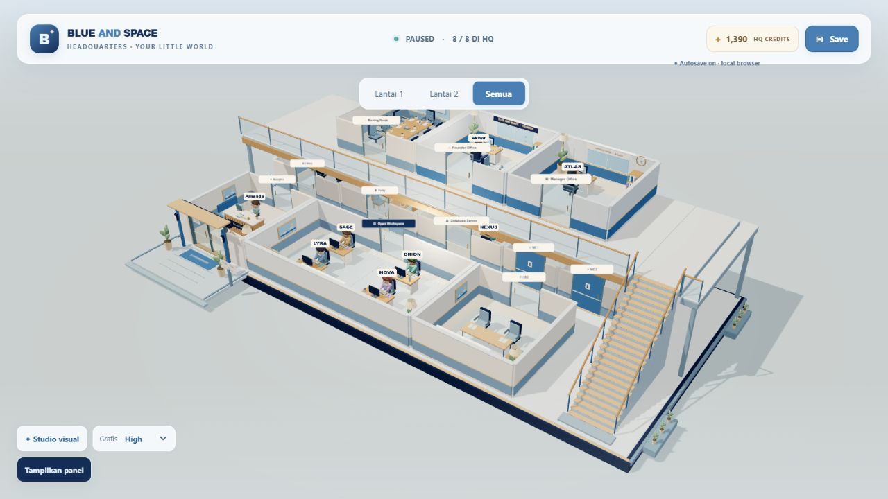
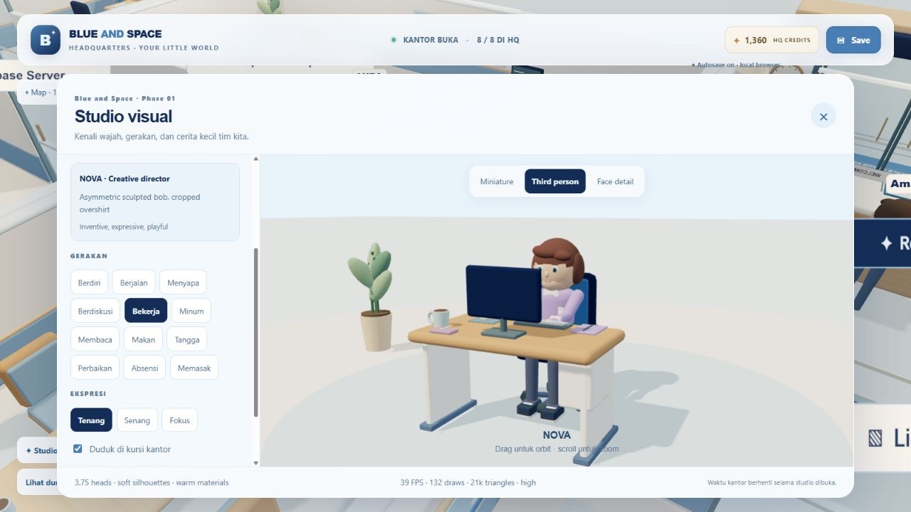
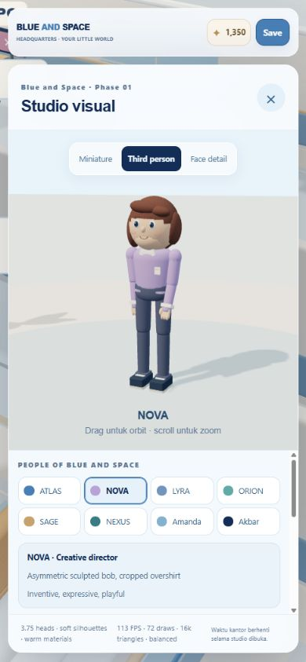

# Blue and Space Headquarters — Phase 01 QA

Dokumen ini merupakan checklist. Hasil diisi dari perintah serta pengamatan build Phase 01 yang benar-benar dijalankan; item tanpa tanda bukan hasil lulus.

## Build dan regresi

- [x] `pnpm build` berhasil: TypeScript dan Vite, 606 modul. Studio dimuat sebagai chunk terpisah.
- [x] `pnpm test`: **40 lulus, 0 gagal**, termasuk migrasi key save dan riwayat identitas.
- [x] Kantor serta Studio visual dimuat di preview produksi port 4173 tanpa error/warning dari origin produksi.
- [x] Judul browser, header, signage, profil, dan dokumen memakai identitas resmi.
- [x] Warna/profil daftar staf sama dengan rig kantor/studio; keduanya membaca `characterProfiles.ts`.
- [x] Studio menahan jam pada 11:03 selama pemeriksaan ponsel; setelah ditutup jam kembali bergerak pada 1x.
- [x] Save browser lokal/migrasi data sebelumnya mempertahankan progres valid; diuji dengan save lama dan baru yang berdampingan.

Pemeriksaan integrasi: **12 Oktober 2026**, Windows/Codex browser preview. Peringatan ukuran bundle Vite masih ada (bundle engine/aplikasi sekitar 359 kB gzip); ini bukan kegagalan build. Warning HMR selama penggantian file development tidak muncul pada origin preview produksi.

## Karakter dan kamera

| Pemeriksaan | Cara mengamati | Catatan yang diperlukan |
| --- | --- | --- |
| Proporsi/siluet | Lineup delapan staf; Miniature dan Third person | Tinggi, kepala, rambut, bahu, pakaian |
| Wajah | Face detail; tiga ekspresi | Mata/alis/mulut terbaca dan tidak saling menutup |
| Gerak | Walk, Stairs, Talk, Wave | Ritme, arah hadap, transisi, benturan tubuh |
| Kursi/komputer | Work dengan furnitur | Pinggul, paha, lutut, kaki, orientasi monitor/tangan |
| Prop kegiatan | Read, Coffee, Eat, Sign, Cook, Repair | Aksesori mengikuti tangan tanpa memotong wajah |
| Pause/motion | Matikan animasi studio; pause kantor; Kurangi animasi | Pose terbaca; fase berulang berhenti/berkurang |
| Dunia bersama | Director → Avatar, dua lantai | Aset/ukuran konsisten; kamera/navigasi dapat digunakan |

## Lingkungan dan UI

- [x] Dua lantai terbaca; ruang kerja lebih besar; dekorasi menjaga jalur/fokus tetap jelas.
- [x] Dinding matte, kayu hangat, kain lembut; highlight dan bayangan kontak terkontrol.
- [ ] Wajah/cream menjaga detail pada cahaya pagi, kerja, dan malam.
- [x] Motif langit/bintang terbatas pada aksen kecil di kantor yang membumi.
- [x] Desktop **1280×720**: panel, studio, pilihan lantai dan mode dapat digunakan; mode Avatar menyembunyikan panel hingga dibuka.
- [x] Portrait **390×844**: preview, pilihan staf, tombol tutup, serta gulir studio dapat dijangkau.
- [ ] Landscape pendek dan pengujian pada perangkat fisik lain.
- [x] Focus terlihat; Escape menutup studio dan mengembalikan fokus ke tombol Studio visual.
- [x] Balanced/High dapat dipilih dan tercermin pada studio; shadow light dibuat ulang saat preset berubah.
- [ ] Audit keyboard lengkap, reduced motion pada semua pose, dan kondisi browser menolak penyimpanan.

Siluet delapan staf, ekspresi dekat NOVA, berdiri, serta duduk/bekerja diperiksa secara visual. Sambungan siku/lutut diperhalus setelah terlihat terlalu terpisah. Pinggul, sol kaki, kursi, orientasi monitor, serta tangan pada keyboard diperiksa pada preview kerja. Kamera Avatar diperbaiki setelah boom dekat pintu terlalu pendek; ia kini mencari sudut lebih tinggi/terbuka sebelum memperpendek jarak, dan gerak mengikuti arah kamera.

## Performa sesi

Studio menampilkan FPS, draw calls, serta segitiga. Ukur bersama viewport/perangkat; satu preview belum mewakili seluruh perangkat.

| Konfigurasi | Perangkat/viewport | FPS | Draw calls | Segitiga |
| --- | --- | ---: | ---: | ---: |
| Balanced · 1 karakter | Preview desktop 1280×720 | 48 | 84 | 17k |
| Balanced · 8 karakter | Preview desktop 1280×720 | 45 | 547 | 128k |
| High · 1 karakter + workstation | Preview produksi 1280×720 | 39 | 132 | 21k |
| Balanced · 1 karakter | Preview produksi portrait 390×844 | 111 | 72 | 16k |
| Kantor dua lantai | Belum diukur | — | — | — |

Nilai merupakan snapshot penghitung renderer dan RAF, berubah sesuai sudut kamera/viewport serta beban komputer. Tabel tidak merupakan perbandingan benchmark dengan scene/perangkat yang sama. Furnitur statis kompatibel digabung berdasarkan material sekali saat ruangan dipasang; screen, pintu, staf dan prop bergerak tetap dinamis.

Balanced membatasi DPR 1,25/shadow map 1024; High DPR 1,75/shadow map 2048. Tinjau pembagian geometri/bahan, segmen mesh, dan jumlah objek dinamis bila biaya renderer meningkat. Targetnya kamera/interaksi yang mulus; belum ada sertifikasi lintas GPU/perangkat.

Pengujian simulasi memeriksa state, perjalanan, durasi, dan save. Ia tidak menilai estetika, penetrasi tubuh per frame, shader, atau GPU. Observasi visual dicatat terpisah. Kontak furnitur masih pose prosedural/titik tetap; IK, skeletal clips, serta penghindaran fisik NPC belum tersedia.

Aturan visual: [ART_DIRECTION.md](ART_DIRECTION.md). Kontrak gerak: [ANIMATION_PLAN.md](ANIMATION_PLAN.md). Menjalankan: [README.md](README.md).
